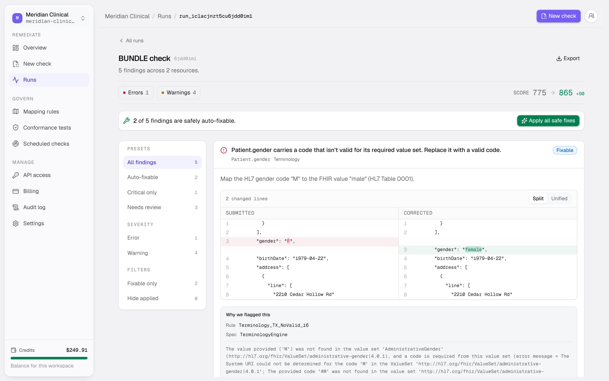
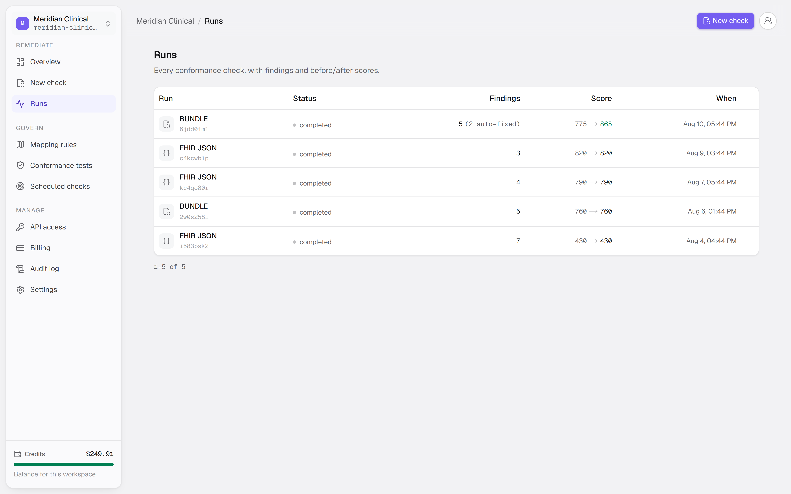
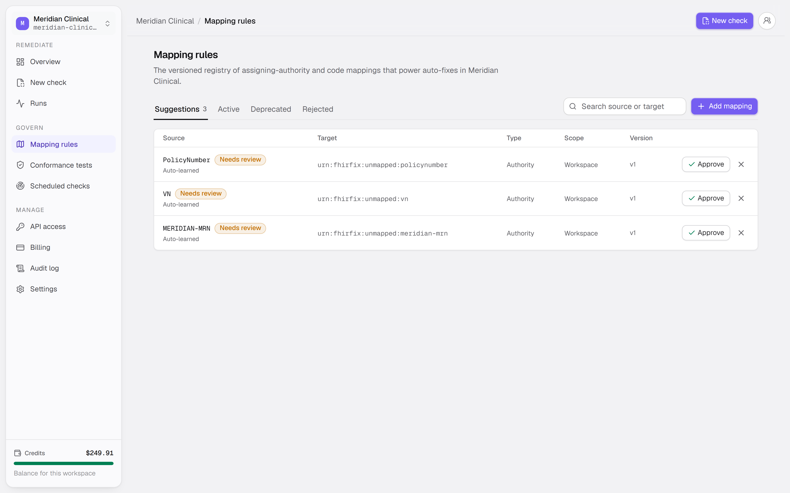
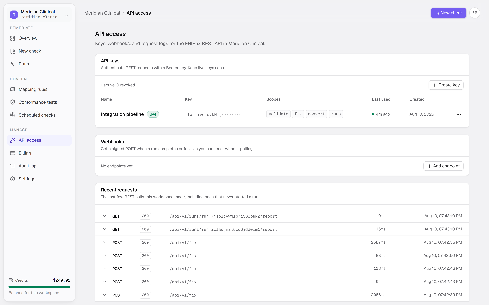
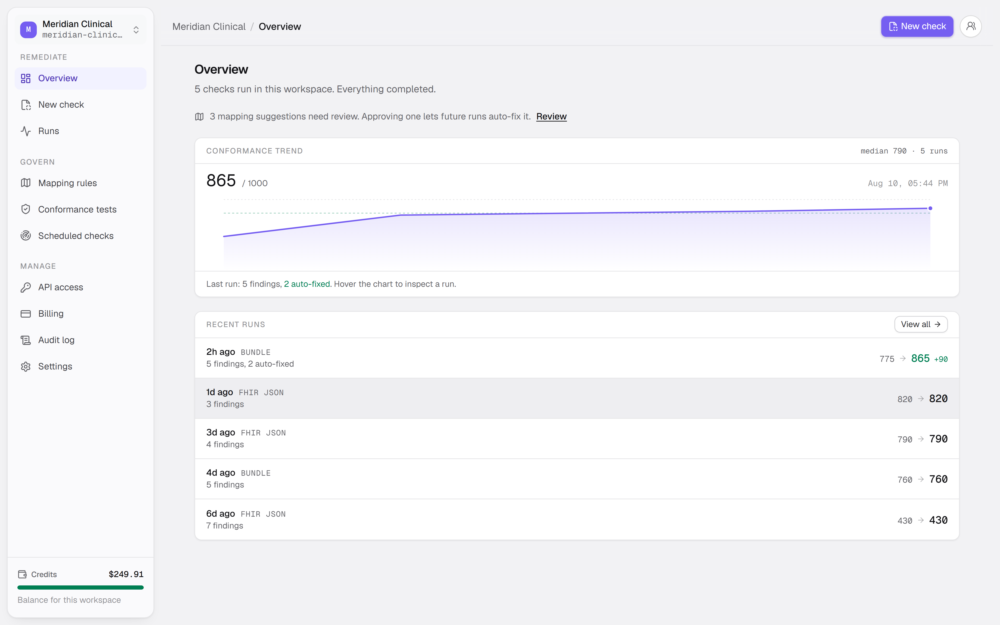

# fhirfix

> Turn a wall of FHIR conformance errors into a ranked, plain-language report with concrete fixes and corrected FHIR.

<p align="center">
  
  
  
  
</p>

<p align="center">
  
</p>

Point it at HL7v2 messages or FHIR resources. It converts, validates against US Core and Da Vinci profiles, ranks and deduplicates the findings, explains each one in plain English, applies the safe deterministic fixes, and re-validates the result.

The remediation logic is deterministic. A finding is detected by a real profile validator, explained against the spec, and its fix derived by cross-referencing the source data against a mapping registry, for example an HL7 assigning authority to a FHIR `identifier.system` URI. A language model polishes the prose and proposes ambiguous mappings; it never decides a fix.

## How it works

1. Input arrives as an HL7v2 message, a FHIR resource, a bundle, NDJSON, or FHIR XML.
2. HL7v2 goes to the converter sidecar and comes back as FHIR.
3. A warm HAPI validator checks the resource and everything it references against the requested profiles.
4. Raw validator output is normalized into findings, each with a rule id, a FHIRPath, and a spec citation.
5. Findings are deduplicated across resources and ranked by severity and blast radius.
6. Each finding is matched against the mapping registry to derive a concrete fix.
7. Safe fixes are applied to a copy of the input. Ambiguous ones are held for review.
8. The corrected resource is re-validated, and the before and after conformance scores are recorded.

## Features

**Ranked findings, not a validator dump.** Every finding carries the rule that produced it, the FHIRPath it applies to, the spec citation, and a plain-language explanation. Duplicates across resources collapse into one row with an occurrence count.

<p align="center">
  
</p>

**Auto-fixes you can inspect before applying.** Fixes are shown as a split diff of the submitted and corrected resource. Safe deterministic corrections can be applied in one action; anything ambiguous is marked for review instead of guessed at.

**A mapping registry that learns.** When a run meets an assigning authority or code system it does not recognize, it records a suggestion. Approving one lets every later run fix that case automatically. Entries are versioned and scoped to a workspace.

<p align="center">
  
</p>

**A REST API, two SDKs, and a CLI.** The endpoints cover validate, fix, convert, batch, and run history, with idempotency keys and scoped keys. JavaScript and Python clients wrap them, and the CLI runs the same checks in a terminal or a CI pipeline.

<p align="center">
  
</p>

**Scheduled checks and drift alerts.** Point a schedule at a source and get told when conformance regresses, rather than finding out at your next integration deadline.

<p align="center">
  
</p>

## Tech

| Layer | Choice |
| --- | --- |
| Frontend | Next.js 16 and React 19. UI only, no business logic or database access |
| Backend | Hono on Bun. Owns the tRPC API, the public REST API, auth, and queue producers |
| Worker | A separate Bun service that consumes the queue and runs detect, rank, fix, re-verify |
| Engine | A shared TypeScript package holding the deterministic conformance logic |
| Validation | HAPI FHIR validator as a sidecar. Profile and terminology validation need a real IG-aware engine |
| Conversion | Microsoft FHIR-Converter for HL7v2 |
| Database | Postgres with Drizzle |
| Queue | Redis with BullMQ |
| Auth | Better Auth, with organizations, SSO, and SCIM |
| Testing | Vitest and bun:test, plus Playwright for browser flows |

## Notes on the stack

**The validator is a sidecar, not a library.** Profile and terminology validation needs the loaded IG packages, and each instance holds around 2GB of them warm. Pure TypeScript cannot do this, so it runs as its own service and the worker routes runs to a ready instance.

**The engine is vendored, not imported.** `db/` and `engine/` are copied into each service by `scripts/sync-shared.mjs` and resolved through `@shared/*`. The services deploy separately but share one Drizzle schema.

**Fixes are derived, not generated.** The mapping registry drives every auto-fix. That is what makes a correction reproducible and reviewable, and it is the part a single prompt to a language model gets wrong.

## Requirements

- Node 24+ and Bun 1.3+
- Docker, for Postgres, Redis, and the validator and converter sidecars

## Running locally

```bash
cp .env.example .env       # fill in DATABASE_URL, REDIS_URL, and the auth secret
docker compose up -d       # postgres, redis, validator, converter
bun install                # backend, worker, engine, db
npm --prefix frontend install
bun run db:push
```

Then start the three services. The worker is not optional: without it, runs are queued and never execute.

```bash
bun run --cwd backend dev    # :3001
npm --prefix frontend run dev  # :3000
bun run --cwd worker dev       # queue consumer
```

The validator loads its US Core packages on first boot and takes a few seconds to report ready. Open `http://localhost:3000`, create an account and a workspace, then paste a resource into a new check. The check page ships with an HL7v2 admit message and a converter-output Patient to start from.

## Project structure

```
backend/    Hono API, tRPC and REST, auth, queue producers
worker/     queue consumer, runs the remediation pipeline
engine/     deterministic conformance and remediation logic
db/         Drizzle schema and data access, vendored into services
frontend/   Next.js app
sdk/        JavaScript and Python clients
cli/        command line tool
action/     GitHub Action wrapping the CLI
```

## Testing

```bash
bun run typecheck              # db, engine, backend, frontend
bun run test                   # db, backend, frontend
bun run --cwd engine test
bun run --cwd cli test
bun run lint
```

Integration tests hit the real validator and converter over HTTP rather than mocks, so Docker needs to be up for those. Browser flows run under Playwright against a built app.
